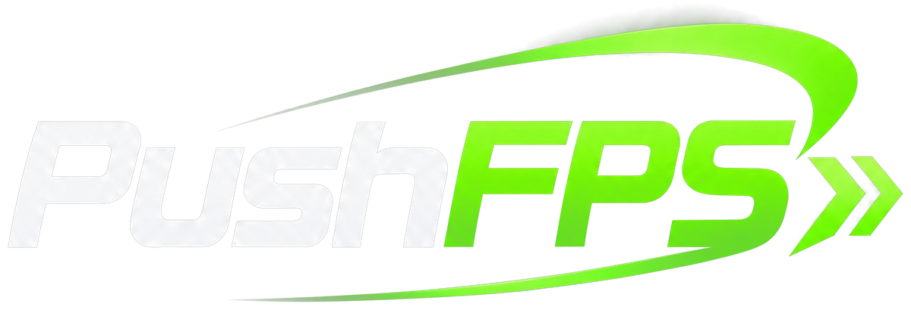
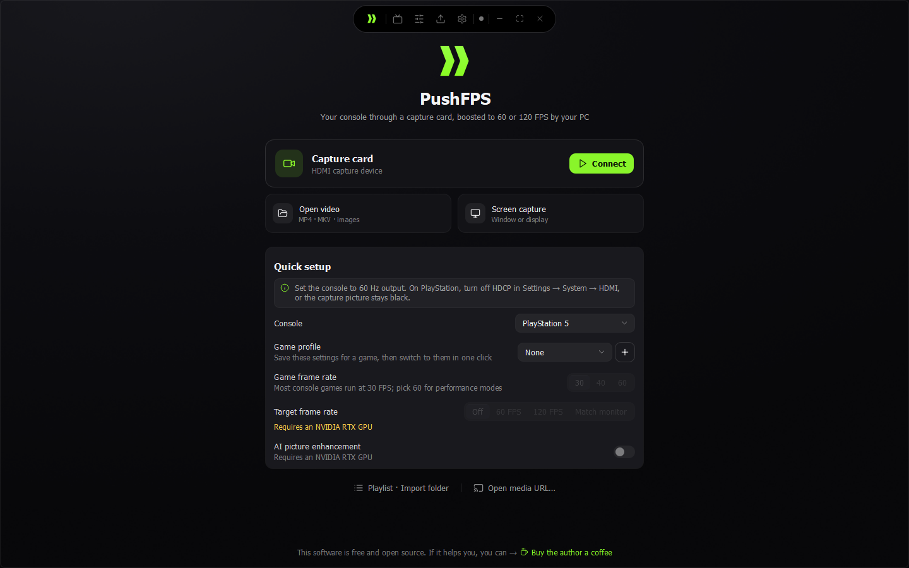
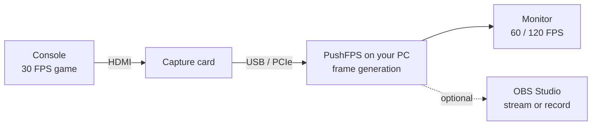
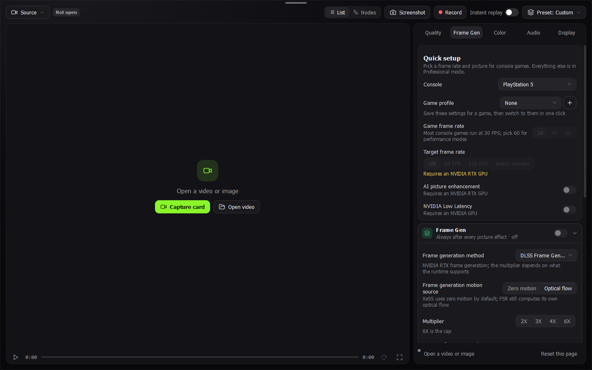
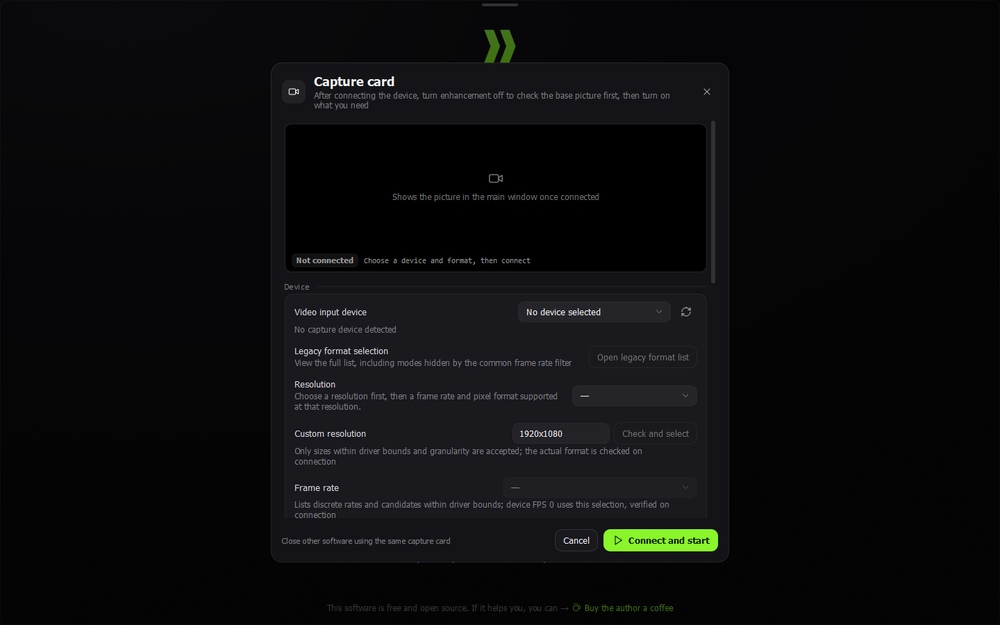
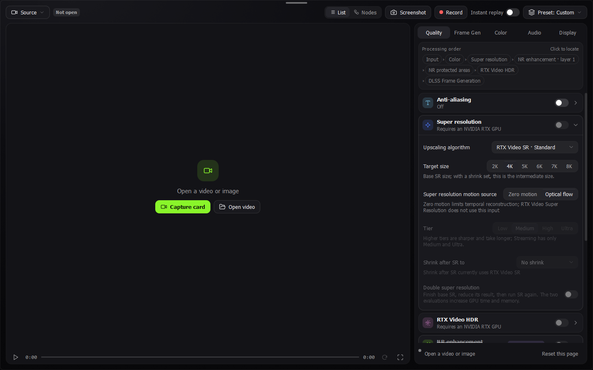
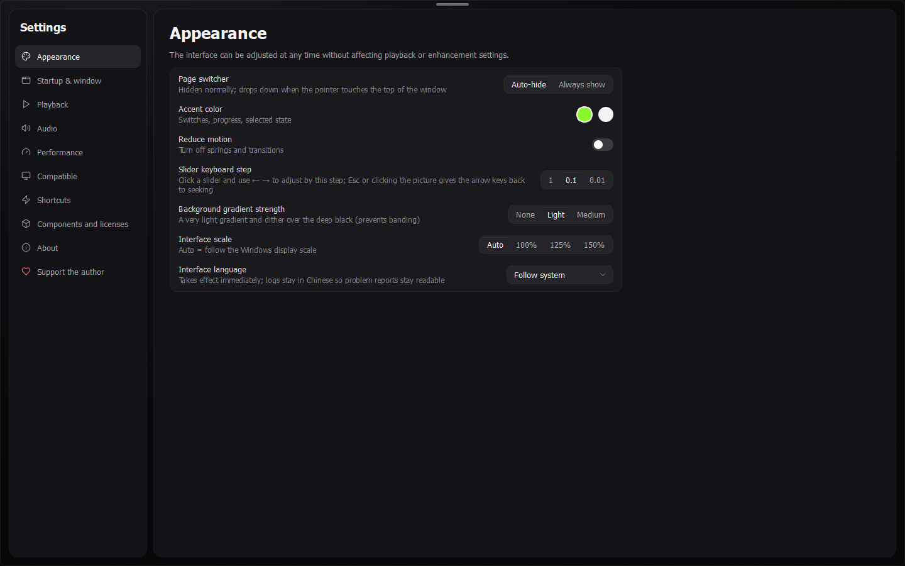

<div align="center">

<picture>
  <source media="(prefers-color-scheme: dark)" srcset="assets/pushfps-logo.png">
  <source media="(prefers-color-scheme: light)" srcset="assets/pushfps-logo-light.png">
  
</picture>

### Play 30 FPS console games at 60 or 120 FPS on your PC monitor.

PushFPS takes the picture from your capture card and adds AI-generated frames in real time.<br>
Nothing changes on the console or in the game: you need a capture card and a graphics card.

[](https://github.com/DosukaSOL/PushFPS/releases)
&nbsp;
[](#obs-studio-plugin)

[](https://github.com/DosukaSOL/PushFPS/releases)
[](https://github.com/DosukaSOL/PushFPS/actions/workflows/build-windows.yml)
[](LICENSE)
[](https://github.com/Likely7/Veyra-NRVideo)

<br>



</div>

---

## Why PushFPS

<table>
<tr>
<td width="33%" valign="top">

**Smoother console games**<br>
A 30 FPS game becomes 60 or 120 FPS, or matches your monitor. PushFPS finds the real frames inside the
60 Hz signal and generates the ones in between on your GPU.

</td>
<td width="33%" valign="top">

**Set up in a minute**<br>
Pick your console, your game's frame rate and the frame rate you want. Save it as a game profile and
switch back in one click.

</td>
<td width="33%" valign="top">

**Frame generation, with or without AI enhancement**<br>
Generate frames only, or also run every frame through AI picture enhancement for a sharper picture
(NVIDIA RTX cards).

</td>
</tr>
<tr>
<td valign="top">

**Any capture card, any RTX card**<br>
Works with capture cards that Windows sees as a camera, from 1080p60 USB sticks to 4K PCIe cards.
RTX 30, 40 and 50 series; AMD Radeon gets 2× with FSR.

</td>
<td valign="top">

**Streams too**<br>
The OBS Studio plugin puts the PushFPS picture, generated frames included, straight into your scenes.

</td>
<td valign="top">

**Free and open source**<br>
GPL-3.0, no account needed. Built on Veyra, the open-source video enhancer by Likely7.

</td>
</tr>
</table>

## How it works



Your console sends its picture to a capture card. PushFPS reads every frame, notices that a 30 FPS game
repeats each picture twice inside the 60 Hz signal, keeps only the real frames, and fills the gaps with
generated frames on your GPU. You play on the PC monitor.

Generated frames make motion smoother. They don't make the game react faster: the controller still feels
like the original 30 FPS, plus a few milliseconds for the capture card and processing.
[More on latency](#latency).

## Screenshots

<table>
<tr>
<td width="50%"><br><sub><b>Frame generation.</b> Quick setup on top, every detail below.</sub></td>
<td width="50%"><br><sub><b>Capture card.</b> Device, format, frame rate, colour and audio in one dialog.</sub></td>
</tr>
<tr>
<td width="50%"><br><sub><b>Picture.</b> Super resolution, AI enhancement layers, HDR.</sub></td>
<td width="50%"><br><sub><b>Settings.</b> Interface, playback, performance, shortcuts.</sub></td>
</tr>
</table>

<sub>Screenshots of the real app, taken automatically on a build machine without a graphics card, so
NVIDIA-only controls show as unavailable. On an RTX PC they are active.</sub>

## Download and install

1. Download the latest **PushFPS-…-win64.zip** from [Releases](https://github.com/DosukaSOL/PushFPS/releases)
   and extract it.
2. Double-click **Install-PushFPS.cmd**.

The installer picks the right package for your graphics card, installs PushFPS to your user folder (no
administrator rights needed), adds Start menu and desktop shortcuts, and starts it.

<details>
<summary>What the installer does, step by step</summary>

PushFPS runs on Veyra's official runtime package: Qt, FFmpeg and the NVIDIA, AMD and Intel components
that Veyra's author distributes. The installer downloads that package (about 750 MB) directly from
[Veyra's GitHub release](https://github.com/Likely7/Veyra-NRVideo/releases), checks its SHA-256 against
the value pinned when the PushFPS release was built, unpacks it, and adds PushFPS on top. PushFPS itself
never rehosts those files.

- **Experimental extras.** Veyra's package also has AI enhancement for RTX 30 and Radeon cards, built on
  NVIDIA files used outside the terms NVIDIA licenses them under. The installer asks whether you want them
  (default no); `Install-PushFPS.cmd -ExperimentalExtras Yes` installs them without asking. Details in
  [NOTICE.md](NOTICE.md).
- Install folder: `%LOCALAPPDATA%\Programs\PushFPS`
- Update: run the newer installer; your settings and profiles are kept
- Uninstall: `Install-PushFPS.cmd -Uninstall`, or delete the folder and shortcuts
- Windows may warn about an unknown publisher (PushFPS isn't code signed yet). Choose *More info*, then
  *Run anyway*, if you downloaded the zip from this repository.

</details>

> [!NOTE]
> Releases marked **Pre-release** are preview builds: built and start-tested automatically on Windows, but
> not yet tested by a person with a capture card and GPU. Reports from real setups are very welcome in
> [Issues](https://github.com/DosukaSOL/PushFPS/issues).

## What you need

| | Minimum | Recommended |
|---|---|---|
| **System** | Windows 11 64-bit with DirectX 12 | Latest Windows updates |
| **Graphics card** | NVIDIA RTX 30 series (frame generation is experimental there) | NVIDIA RTX 40 or 50 series |
| **Capture card** | Any card that shows up as a camera in Windows and sends 1080p at 60 FPS without compression | A card with 4K60 capture and passthrough |
| **Connection** | USB 3 port directly on the PC (no hub) | USB 3.2 Gen 2 or a PCIe card |
| **Console** | Any console with HDMI out | Set to 60 Hz output |

AMD Radeon cards can use FSR frame generation (2× only, so 60 FPS from a 30 FPS game). AI picture
enhancement on Radeon and on RTX 30 cards is an optional experimental extra (see below).

<details>
<summary>Which frame generation methods your PC offers</summary>

| Method | Graphics cards | Most frames per real frame |
|---|---|---|
| NVIDIA Video Frame Generation (VFG) | RTX 40, RTX 50 (RTX 30 experimental) | 8× |
| NVIDIA DLSS Frame Generation | RTX 40 (2×), RTX 50 (up to 6×) | 6× |
| Intel XeSS Frame Generation (experimental) | DirectX 12 cards; Veyra tested it on NVIDIA | 4× |
| AMD FSR Frame Generation | DirectX 12 cards (FSR 4 needs a Radeon RX 9000) | 2× |

</details>

## Get started

1. **Connect everything.** Console HDMI out goes into the capture card's input. The card's USB or PCIe
   connection goes into the PC. If the card has an HDMI passthrough, you can leave a TV on it.
2. **Set the console to 60 Hz.** Even for 30 FPS games, consoles send a 60 Hz signal. 1080p is enough for
   most cards; use 4K if your card captures 4K60.
3. **PlayStation only: turn HDCP off.** Settings, System, HDMI, turn off *Enable HDCP*. With HDCP on, the
   capture card only shows black. Xbox and Switch games are not HDCP protected.
4. **Open PushFPS and fill in the quick setup** on the home screen:

   | Setting | What to pick |
   |---|---|
   | **Console** | PlayStation 5, PS5 Pro, Xbox Series X\|S, Nintendo Switch 2 or Other. Each console remembers its own choices |
   | **Game profile** | Optional: save the current settings under a game's name, switch to them later in one click |
   | **Game frame rate** | 30 for most games (GTA VI), 40 for 40 FPS modes, 60 for performance modes |
   | **Target frame rate** | Off, 60 FPS, 120 FPS or Match monitor. PushFPS picks the frame generation multiplier |
   | **AI picture enhancement** | Off: frame generation only. On: every frame also goes through AI enhancement on RTX 40/50 cards (RTX 30 and Radeon: experimental extra). Uses a lot more GPU, so start with it off |

5. **Click Connect** on the capture card. Choose your card, its resolution, 60 FPS and the card's audio input.
6. Press **F11** (or Alt+Enter), or double-click the picture, for fullscreen.

> [!TIP]
> Close other apps that use the capture card (OBS, the card's own software) before connecting.
> Only one program can use a capture card at a time. To show PushFPS in OBS, use the
> [OBS Studio plugin](#obs-studio-plugin) instead.

## Profiles

**Console profiles.** Switching the console in the quick setup keeps what you set for the previous console
and brings back what you set for the new one: game frame rate, target frame rate, AI enhancement and
NVIDIA Low Latency. The setup tip on the home screen follows the console too.

**Game profiles.** Click **+** next to *Game profile*, type a name (for example *GTA VI*) and confirm. The
profile stores the console, game frame rate, target, AI enhancement and low latency. If the Professional
settings currently match a saved preset, the profile remembers that preset as well and applies it first, so
a game profile can carry every detail. Pick the game from the list to switch; the bin removes it.

## Picture and sound

Open **Picture & sound** on the home screen to adjust the picture and sound before you play or record:

| Control | What it does |
|---|---|
| **Presets** | *Natural*, *Vivid*, *Cinematic* or *Bright* as a starting point |
| **Brightness, contrast, gamma, saturation, sharpness** | Fine-tune the look. *Reset* goes back to the original picture, *Undo* takes back the last change |
| **More colour controls** | Opens the full colour editor in Professional mode: curves, colour wheels, LUTs, saved looks |
| **Sound profile** | *Bass boost*, *Voice clarity*, *Footsteps*, *Night mode* (quiet sounds louder, loud sounds softer), *Cinema*, or your own 5-band equaliser |

Everything you set here is part of the picture and sound you see, hear and record. Sound profiles are
also in Professional mode under *Audio*. Dolby and DTS passthrough to a receiver are not changed.

**After recording.** When a recording is saved, a card offers **Edit** (opens it in the editor),
**Export** (trim, pick tracks, re-encode) and **Show in folder**.

## OBS Studio plugin

The plugin adds a **PushFPS** source to OBS Studio 28 or newer on Windows. It shows the PushFPS picture,
generated frames included, in any scene, and can start PushFPS for you.

1. Download **PushFPS-OBS-Plugin-…-win64.zip** from [Releases](https://github.com/DosukaSOL/PushFPS/releases)
   and extract it.
2. Close OBS Studio and double-click **Install-PushFPS-OBS.cmd** (no administrator rights needed).
3. Start OBS Studio. Under *Sources*, click **+** and pick **PushFPS**.

| In the source's properties | What it does |
|---|---|
| **Open PushFPS** | Starts PushFPS with OBS game capture support, or brings it to the front (also under *Tools*) |
| **Capture method** | *Game capture* receives every generated frame (recommended). *Window capture* is the fallback |
| **Start PushFPS when this source is shown** | On by default |
| **PushFPS.exe location** | Only needed if PushFPS isn't in its default folder |

For sound, add an *Application Audio Capture* source and pick `PushFPS.exe`. If you start PushFPS yourself
instead of from OBS, turn on *Settings, Compatible, OBS Game Capture compatibility* in PushFPS once and
restart it. Uninstall: `Install-PushFPS-OBS.cmd -Uninstall`.

<sub>How it works: PushFPS keeps doing the processing on your GPU; the plugin drives OBS's own game capture
(or window capture) pointed at the PushFPS window. Every build is loaded into the latest OBS Studio on
GitHub Actions, which opens a scene with a PushFPS source, lets it start PushFPS and checks that it finds
the window.</sub>

## Tune it for your setup

| If you see | Try |
|---|---|
| Black picture from a PlayStation | Turn HDCP off on the console |
| Stutter every second or so | Set the capture card to exactly 60 FPS, close other apps that use the card, use a USB port directly on the PC |
| Smeared HUD or text during fast motion | Pick a lower target (60 instead of 120), or a higher frame generation quality in Professional mode |
| Picture looks washed out | Match the colour settings in the capture dialog to the console: HDR (PQ) or SDR, Limited or Full range |
| The game feels slow to react | Turn on NVIDIA Low Latency. Frame generation can't reduce the game's own delay |
| Frame rate drops with AI enhancement on | Turn AI enhancement off, or lower its resolution in Professional mode |

## Latency

To place a frame between two real frames, PushFPS has to wait for the second one. With a 30 FPS game that
adds up to one frame (about 33 ms) on top of the capture card's own delay, which depends on the card.
Generated frames make motion look like 120 FPS, but your inputs still take effect at the game's own pace.

For fast competitive games, use **Off** and play on the console's own display path.

## FAQ

**Does it work with games that already run at 60 FPS?**
Yes. Set *Game frame rate* to 60 and pick 120 FPS or Match monitor: a 60 FPS game gets one generated frame
in between (two on a 240 Hz monitor).

**Does it change the console or the game?**
No. PushFPS only processes the video coming out of the capture card. Nothing is installed on the console.

**Is it free?**
Yes. PushFPS is free and open source under the GPL-3.0, like Veyra.

**Is there a macOS version?**
Not yet. The frame generation in PushFPS runs on NVIDIA, AMD and Intel graphics through DirectX 12 on
Windows. A macOS version needs a separate engine and is planned for later.

**Where are my settings and profiles stored?**
In your user folder, next to Veyra's settings. Updating PushFPS keeps them.

## Roadmap

- [x] PushFPS name, logo and update channel
- [x] Quick setup: target frame rate, frame generation with or without AI enhancement
- [x] Windows release with automated, reproducible builds
- [x] Per-console and per-game profiles
- [x] OBS Studio plugin
- [x] Cleaner interface: capture card first, less text, aligned controls
- [x] Picture and sound editor, sound profiles, edit after recording
- [ ] NVIDIA Image Scaling (NIS) sharpening and upscaling
- [ ] Tested settings for popular capture cards, from real-hardware reports
- [ ] macOS version

## Build from source

Every push builds PushFPS on GitHub Actions ([build-windows.yml](.github/workflows/build-windows.yml)), and
that workflow is the build recipe: Visual Studio 2022, CMake with Ninja, Qt 6.8.3, FFmpeg 9.0.1 from vcpkg
at the pinned baseline, the NVIDIA DLSS SDK 310.7.0, nv-codec-headers, the CUDA driver header, Intel XeSS
3.0.2 and AMD FidelityFX 1.1.4 and 2.3.0. All of them are downloaded from their official public sources at
pinned versions; none is committed. The workflow then runs the unit and interface tests, checks that
`PushFPS.exe` links exactly the Qt and FFmpeg libraries in Veyra's runtime package, installs it with the real
installer and opens every main page, failing on any interface error.

The NVIDIA Optical Flow SDK needs a developer login, so release builds leave it out and use AMD FidelityFX
optical flow for motion estimation instead (it runs on any DirectX 12 GPU). NVIDIA Video Frame Generation
has its own optical flow and is not affected. If you build locally with the Optical Flow SDK in
`third_party_local/nvidia/Optical_Flow_SDK_5.0.7`, NVIDIA optical flow is available as in Veyra.

The OBS plugin ([obs-plugin/](obs-plugin)) is a small C module built against OBS's public headers:

```
cmake -S obs-plugin -B build-obs -A x64 -DOBS_SOURCE_DIR=<obs-studio checkout>
cmake --build build-obs --config Release
```

More background: [docs/DEVELOPMENT.md](docs/DEVELOPMENT.md), [THIRD_PARTY_NOTICES.md](THIRD_PARTY_NOTICES.md).
Inside the code, PushFPS keeps Veyra's names (namespaces, targets, the `qml/Veyra` module) so fixes from
Veyra keep merging cleanly. The PushFPS name and links live in
[`include/veyra/Brand.h`](include/veyra/Brand.h).

## Credits and license

PushFPS is a modified version of **[Veyra](https://github.com/Likely7/Veyra-NRVideo)** by
**[Likely7](https://github.com/Likely7)**, forked on 2026-11-12. Nearly all of the engine, the capture
support and the frame generation integration is their work. If PushFPS helps you, consider
[supporting Veyra's author](https://www.patreon.com/cw/Likely7).

- PushFPS and Veyra code: [GPL-3.0](LICENSE). Files written for PushFPS, including the OBS plugin, are
  GPL-3.0-or-later. What PushFPS changed, and where each release's source is: [NOTICE.md](NOTICE.md).
- PushFPS.exe incorporates the NVIDIA DLSS SDK and NGX SDK under the NVIDIA RTX SDKs License, and uses the
  AMD FidelityFX SDK and the Intel XeSS SDK; their licenses ship in `licenses/sdk` of every release. For the
  code written for PushFPS, its authors grant an additional permission (GPL-3.0 section 7) to combine it with
  these SDKs; see [NOTICE.md](NOTICE.md), which also lists what the installer leaves out for licensing reasons.
- PushFPS comes with absolutely no warranty, as the GPL-3.0 states. The app shows the license and a link to
  this source under *Settings, About*.
- The PS5 Remote Play part (Chiaki) is also under the AGPL-3.0 with an OpenSSL exception; see
  [licenses/remoteplay](licenses/remoteplay).
- Third-party components and their licenses: [THIRD_PARTY_NOTICES.md](THIRD_PARTY_NOTICES.md).

PushFPS is not affiliated with or endorsed by NVIDIA, AMD, Intel, Sony, Microsoft, Nintendo, the OBS Project
or any game publisher. NVIDIA, RTX and DLSS are trademarks of NVIDIA Corporation. PlayStation is a trademark
of Sony Interactive Entertainment. Xbox is a trademark of Microsoft. Nintendo Switch is a trademark of
Nintendo. OBS Studio is a trademark of the OBS Project.
