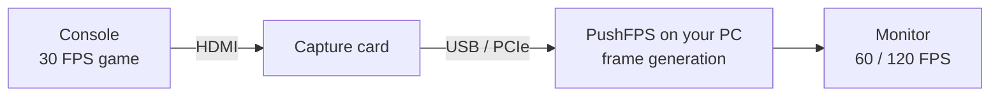

<picture>
  <source media="(prefers-color-scheme: dark)" srcset="assets/pushfps-logo.png">
  <source media="(prefers-color-scheme: light)" srcset="assets/pushfps-logo-light.png">
  
</picture>

### Play 30 FPS console games at 60 or 120 FPS on your PC monitor.

PushFPS takes the picture from your capture card and adds AI-generated frames in real time.
No changes to the console or the game, just a capture card and a graphics card.

---

## How it works

Your console sends its picture to a capture card. PushFPS reads every frame, notices that a 30 FPS game
repeats each picture twice inside the 60 Hz signal, keeps only the real frames, and fills the gaps with
generated frames on your GPU. You play on the PC monitor.

Generated frames make motion smoother. They don't make the game react faster: the controller still feels
like the original 30 FPS, plus a few milliseconds for the capture card and processing.
[More on latency](#latency).

## Download

> [!NOTE]
> **The first PushFPS release is being prepared.** There is no PushFPS download yet. When it's ready it
> will appear under [Releases](https://github.com/DosukaSOL/PushFPS/releases), and PushFPS will tell
> you about every new version from then on.

## What you need

| | Minimum | Recommended |
|---|---|---|
| **System** | Windows 11 64-bit with DirectX 12 | Latest Windows updates |
| **Graphics card** | NVIDIA RTX 30 series (frame generation is experimental there) | NVIDIA RTX 40 or 50 series |
| **Capture card** | Any card that shows up as a camera in Windows and sends 1080p at 60 FPS without compression | A card with 4K60 capture and passthrough |
| **Connection** | USB 3 port directly on the PC (no hub) | USB 3.2 Gen 2 or a PCIe card |
| **Console** | Any console with HDMI out | Set to 60 Hz output |

AMD Radeon cards can use FSR frame generation (2× only, so 60 FPS from a 30 FPS game).

Which frame generation methods your PC offers:

| Method | Graphics cards | Most frames per real frame |
|---|---|---|
| NVIDIA Video Frame Generation (VFG) | RTX 40, RTX 50 (RTX 30 experimental) | 8× |
| NVIDIA DLSS Frame Generation | RTX 40 (2×), RTX 50 (up to 6×) | 6× |
| Intel XeSS Frame Generation (experimental) | DirectX 12 cards; Veyra tested it on NVIDIA | 4× |
| AMD FSR Frame Generation | DirectX 12 cards (FSR 4 needs a Radeon RX 9000) | 2× |

## Get started

1. **Connect everything.** Console HDMI out goes into the capture card's input. The card's USB or PCIe
   connection goes into the PC. If the card has an HDMI passthrough, you can leave a TV on it.
2. **PlayStation only: turn HDCP off.** Settings, System, HDMI, turn off *Enable HDCP*. With HDCP on,
   the capture card only shows black.
3. **Set the console to 60 Hz.** Even for 30 FPS games, consoles send a 60 Hz signal. 1080p is enough for
   most cards; use 4K if your card captures 4K60.
4. **Open PushFPS** and pick **Capture card** on the home screen. Choose your card, its resolution, 60 FPS,
   and the card's audio input.
5. **Choose your target frame rate** in the quick setup on the home screen or under Professional,
   Frame generation:

   | Choice | What happens |
   |---|---|
   | **Off** | You see the console's own frame rate |
   | **60 FPS** | A 30 FPS game gets one generated frame between real frames (2×) |
   | **120 FPS** | A 30 FPS game gets three generated frames between real frames (4×) |
   | **Match monitor** | As many frames as your monitor can show |

6. **Choose the picture.** With *AI picture enhancement* off, PushFPS only generates frames. Turn it on
   to also run every frame through NVIDIA's neural renderer for a sharper picture. That costs a lot more
   GPU power, so start with it off.
7. Press **F11** (or Alt+Enter), or double-click the picture, for fullscreen.

> [!TIP]
> Close other apps that use the capture card (OBS, the card's own software) before connecting.
> Only one program can use a capture card at a time.

## What PushFPS adds to Veyra

PushFPS is built on [Veyra](https://github.com/Likely7/Veyra-NRVideo), an excellent open-source video
enhancer by Likely7. Veyra does far more than console frame generation: video files, streaming, export,
up to four layers of neural enhancement, a node editor. PushFPS focuses on one job, making console games
smoother, and makes that job simple.

- **Quick setup.** Target frame rate, AI enhancement and low latency in three controls, on the home screen
  and above the detailed settings. Everything stays adjustable in Professional mode.
- **Frame generation on its own.** Use frame generation without the neural picture enhancement, or with it.
- **English-first.** English as the main language of the docs, alongside Veyra's Chinese, Traditional
  Chinese and Japanese interface.
- **Its own updates.** PushFPS checks this repository for new versions, so it never offers a Veyra release
  in place of a PushFPS one.

Everything Veyra can do is still there: HDR capture, VRR, NVIDIA Low Latency, super resolution, colour
tools, PS5 Remote Play, Xbox and PC streaming, screenshots (F7) and recording (F8).

## Tune it for your setup

| If you see | Try |
|---|---|
| Black picture from a PlayStation | Turn HDCP off on the console |
| Stutter every second or so | Set the capture card to exactly 60 FPS, close other apps that use the card, use a USB port directly on the PC |
| Smeared HUD or text during fast motion | Pick a lower target (60 instead of 120), or a higher frame generation quality in Professional mode |
| Picture looks washed out | Match the colour settings in the capture dialog to the console: HDR (PQ) or SDR, Limited or Full range |
| The game feels slow to react | Turn on NVIDIA Low Latency. Frame generation can't reduce the game's own delay |
| Frame rate drops with AI enhancement on | Turn AI enhancement off, or lower its resolution in Professional mode |

## Latency

To place a frame between two real frames, PushFPS has to wait for the second one. With a 30 FPS game that
adds up to one frame (about 33 ms) on top of the capture card's own delay, which depends on the card. Generated frames make motion look like 120 FPS, but your inputs still take effect at
the game's own pace.

For fast competitive games, use **Off** and play on the console's own display path.

## FAQ

**Does it work with games that already run at 60 FPS?**
Yes. PushFPS detects the real frame rate. A 60 FPS game with a 120 FPS target gets one generated frame in
between.

**Does it change the console or the game?**
No. PushFPS only processes the video coming out of the capture card. Nothing is installed on the console.

**Is it free?**
Yes. PushFPS is free and open source under the GPL-3.0, like Veyra.

**Is there a macOS version?**
Not yet. The frame generation in PushFPS runs on NVIDIA, AMD and Intel graphics through DirectX 12 on
Windows. A macOS version needs a separate engine and is planned for later.

**Can I use PushFPS inside OBS Studio?**
Not as an OBS plugin yet; it is on the roadmap. Today you can capture the PushFPS window in OBS with
*Window Capture*, or turn on *Settings, General & appearance, OBS Game Capture compatibility* and use
*Game Capture*.

## Roadmap

- [x] PushFPS name, logo and update channel
- [x] Quick setup: target frame rate, frame generation with or without AI enhancement
- [ ] First Windows release with automated, reproducible builds
- [ ] Per-console and per-game profiles
- [ ] OBS Studio plugin
- [ ] macOS version

## Build from source

PushFPS builds the same way as Veyra: Visual Studio 2022 (MSVC), CMake with Ninja, Qt 6.8.3, a patched
FFmpeg 9.0.1, and NVIDIA, AMD and Intel SDKs that are downloaded separately and never committed. See
[docs/DEVELOPMENT.md](docs/DEVELOPMENT.md), [docs/BUILD_2.1.5.md](docs/BUILD_2.1.5.md) and
[THIRD_PARTY_NOTICES.md](THIRD_PARTY_NOTICES.md). The program builds as `PushFPS.exe`.

Inside the code, PushFPS keeps Veyra's names (namespaces, targets, the `qml/Veyra` module) so fixes from
Veyra keep merging cleanly. The PushFPS name and links live in
[`include/veyra/Brand.h`](include/veyra/Brand.h).

## Credits and license

PushFPS is a fork of **[Veyra](https://github.com/Likely7/Veyra-NRVideo)** by
**[Likely7](https://github.com/Likely7)**. Nearly all of the engine, the capture support and the frame
generation integration is their work. If PushFPS helps you, consider
[supporting Veyra's author](https://www.patreon.com/cw/Likely7).

- PushFPS and Veyra code: [GPL-3.0](LICENSE).
- The PS5 Remote Play part (Chiaki) is also under the AGPL-3.0 with an OpenSSL exception; see
  [licenses/remoteplay](licenses/remoteplay).
- Third-party components and their licenses: [THIRD_PARTY_NOTICES.md](THIRD_PARTY_NOTICES.md).

PushFPS is not affiliated with or endorsed by NVIDIA, AMD, Intel, Sony, Microsoft or any game publisher.
NVIDIA, RTX and DLSS are trademarks of NVIDIA Corporation. PlayStation is a trademark of Sony Interactive
Entertainment. Xbox is a trademark of Microsoft.
