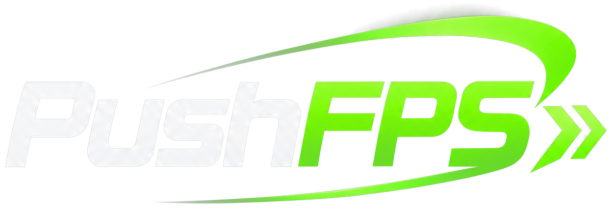
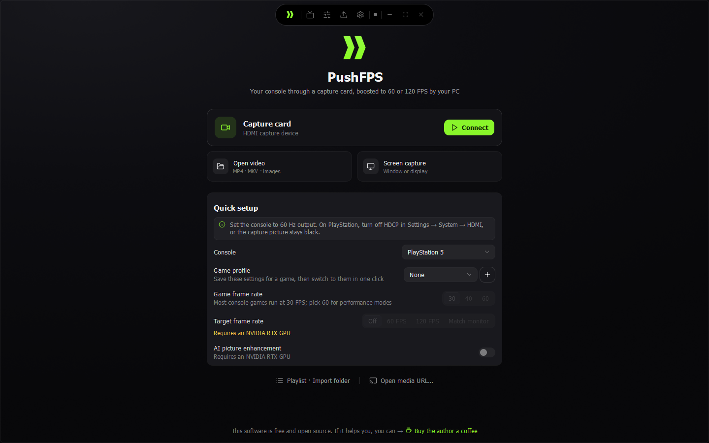

  
    
  

# PushFPS

[English](README.md) | 简体中文

PushFPS 让 30 FPS 的主机游戏在电脑显示器上以 60 或 120 FPS 运行：从采集卡读取画面，在显卡上实时补帧。主机和游戏都不需要改动。

PushFPS 基于开源项目 [Veyra](https://github.com/Likely7/Veyra-NRVideo)（作者 Likely7，GPL-3.0）。几乎全部引擎、采集和补帧接入都来自 Veyra；PushFPS 专注于主机补帧，并把它做得更简单：

- **快速设置**：目标帧率（关闭 / 60 FPS / 120 FPS / 跟随显示器）、AI 画面增强、英伟达低延迟，三个控件即可完成；详细参数仍在专业模式中。
- **可以只补帧**：AI 画面增强（NVIDIA 神经渲染）可单独开关。
- **主机与游戏配置**：选择主机（PS5、PS5 Pro、Xbox Series X|S、Switch 2），每台主机记住自己的设置；可把当前设置存为某个游戏的配置，一键切换。
- **更清爽的界面**：首页以采集卡为主，提示文字更少，控件对齐。
- **OBS Studio 插件**：在 OBS 中添加 “PushFPS” 来源，直接显示补帧后的画面，见 [英文 README](README.md#obs-studio-plugin)。
- **独立更新**：PushFPS 只检查本仓库的新版本。

完整说明（安装、硬件要求、设置建议、延迟说明、常见问题）见 [英文 README](README.md)。

Veyra 的中文文档与历史记录保留在 [docs/](docs/README.md) 中，也可以在 [Veyra 仓库](https://github.com/Likely7/Veyra-NRVideo) 阅读。如果 PushFPS 对你有帮助，欢迎[支持 Veyra 的作者](https://www.patreon.com/cw/Likely7)。

许可：GPL-3.0；PS5 串流部分（Chiaki）同时适用 AGPL-3.0 及 OpenSSL 例外，见 [licenses/remoteplay](licenses/remoteplay)。PushFPS 与 NVIDIA、AMD、Intel、Sony、Microsoft 及任何游戏发行商无关。
